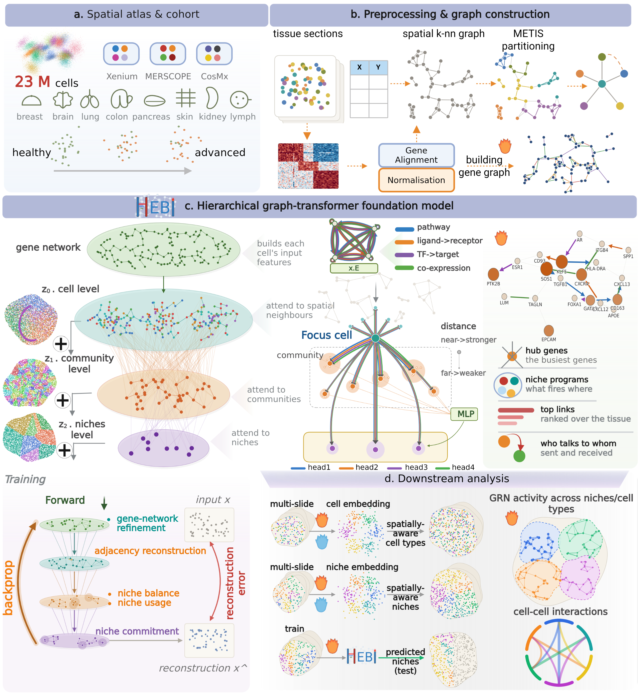

# HEBI

**A hierarchical graph foundation model for spatial transcriptomics.**

HEBI learns cell, prototype, and niche level representations of a tissue
section in a single forward pass, without cell type or niche annotations.
It is pretrained on 80 imaging-based sections spanning three commercial
platforms and 23 million cells, and transfers to unseen sections either
zero-shot or after a short continual adaptation.

<p align="center">
  
</p>

Niches are read directly from the model's attention rather than by
clustering an embedding afterwards, so niche labels are comparable across
replicate sections and across platforms without a separate batch
correction step.

---

## Installation

HEBI needs Python 3.11+, PyTorch and `torch_sparse`. Both are built per
CUDA version, so they are installed first, then the package.

The commands below use PyTorch 2.6.0 with CUDA 12.4, the versions HEBI was
developed with. For another CUDA version, or CPU only, change `cu124` in
both URLs (e.g. `cu118`, `cu126`, `cpu`); see
[pytorch.org](https://pytorch.org/get-started/locally/) and the
[PyG install guide](https://pytorch-geometric.readthedocs.io/en/latest/install/installation.html).

### conda / mamba

`environment.yml` installs PyTorch and `torch_sparse` through pip, since
PyTorch is no longer published on its conda channel after 2.5.

```bash
git clone https://github.com/roxana9/hebi.git
cd hebi
mamba env create -f environment.yml
mamba activate hebi
pip install -e .
```

### pip

```bash
# 1. PyTorch, matching your CUDA version
pip install torch==2.6.0 --index-url https://download.pytorch.org/whl/cu124

# 2. torch_sparse, a prebuilt wheel matching that PyTorch + CUDA build
pip install torch_sparse -f https://data.pyg.org/whl/torch-2.6.0+cu124.html

# 3. HEBI
git clone https://github.com/roxana9/hebi.git
cd hebi
pip install -e .
```

If `torch_sparse` starts compiling from source, the `torch-X+cuY` part of
the `-f` URL does not match the installed PyTorch. Check it with
`python -c "import torch; print(torch.__version__)"`.

Optional clustering backends:

```bash
pip install -e ".[leiden]"    # --cluster_method leiden
pip install -e ".[mclust]"    # --cluster_method mclust, also needs R + mclust
```

Check the install:

```bash
hebi-run --help
```

---

## Pretrained weights

The pretrained checkpoint and the gene vocabulary are on Hugging Face:
[huggingface.co/Roxana9/hebi](https://huggingface.co/Roxana9/hebi)

| file | content |
| --- | --- |
| `hebi_hybrid_oldL0.pt` | pretrained HEBI weights |
| `default_gene_vocab.json` | gene vocabulary used for pretraining |

Download with the Hugging Face CLI:

```bash
pip install -U huggingface_hub
hf download Roxana9/hebi --local-dir weights/
```

or from Python:

```python
from huggingface_hub import hf_hub_download

ckpt = hf_hub_download("Roxana9/hebi", "hebi_hybrid_oldL0.pt")
vocab = hf_hub_download("Roxana9/hebi", "default_gene_vocab.json")
```

Then pass them to `hebi-run`:

```bash
hebi-run --checkpoint_path weights/hebi_hybrid_oldL0.pt \
         --vocab_path weights/default_gene_vocab.json ...
```

Without a checkpoint, `--init random` trains from scratch on your own sections.


---

## Quick start

Three steps: preprocess sections, run inference, read the outputs.

### 1. Preprocess

Turns each `.h5ad` into a `.pt` section holding the expression matrix,
the spatial kNN graph, and the METIS partition.

```bash
hebi-preprocess \
  --h5ad_dir data/my_sections/ \
  --out_root processed/ \
  --vocab_path default_gene_vocab.json \
  --k 5
```

`--k` is the spatial neighbourhood size and should suit the cell density
of your data. The value used is recorded in each `.pt`.

Normalisation is detected, not assumed. `log1p` is applied when the
matrix is not already in log space; library-size normalisation is
separate and opt-in via `--normalise`. The detected status is printed and
stored, so a section's space is always recoverable.

### 2. Run

```bash
hebi-run \
  --checkpoint_path hebi_foundation.pt \
  --data_dir processed/ \
  --section_files section_1.pt section_2.pt \
  --h5ad_files data/my_sections/section_1.h5ad data/my_sections/section_2.h5ad \
  --vocab_path default_gene_vocab.json \
  --mode zero_shot \
  --init pretrained \
  --n_cell_clusters 18 \
  --cluster_method kmeans \
  --seed 2025 \
  --point_size 2 \
  --output_dir results/
```

Or put the same settings in a YAML file:

```bash
hebi-run --config configs/starmap.yaml
```

### 3. Outputs

HEBI produces cell-level embeddings and niche assignments directly from its hierarchical encoder. Cell clusters are obtained by clustering the Level-0 embeddings, whereas niche assignments are derived directly from Level-2 attention without post-hoc clustering.

**Generated figures**

When plotting is enabled, `--output_dir` contains:

```text
results/
└── z0_kmeans_18.*    # Joint cell-level clustering across sections
```

The number in the filename corresponds to `--n_cell_clusters`. Prototype assignments are available directly from the model but are not yet plotted automatically by the CLI.

**AnnData representations**

For each section, the following results are available in memory:

| Location | Key | Description |
| --- | --- | --- |
| `adata.obs` | `prototypes` | Learned Level-2 niche assignments, obtained directly from the attention argmax |
| `adata.obs` | `z0_kmeans_18` | Cell clusters obtained by jointly clustering Level-0 embeddings across sections |
| `adata.obsm` | `z0` | Cell-level representations |
| `adata.obsm` | `z1` | Community-contextualised cell representations |
| `adata.obsm` | `z2` | Niche-level cell representations |

The number of cell clusters is configurable through `--n_cell_clusters`. The number of learned niche prototypes is defined by the model architecture and checkpoint, not by the clustering parameters.

**Note:** The current CLI does not automatically export the resulting AnnData objects as `.h5ad` files.

## Python API

HEBI can be run through a single function or as separate stages, allowing users to explore different cell-clustering and niche-assignment settings without repeating model inference.

### Option 1: Complete pipeline

```python
from hebi.inference.pipeline import run_hebi

sections, ctx = run_hebi(
    checkpoint_path="hebi_foundation.pt",
    data_dir="processed/",
    section_files=["section_1.pt", "section_2.pt"],
    h5ad_files=["section_1.h5ad", "section_2.h5ad"],
    vocab_path="default_gene_vocab.json",
    mode="zero_shot",
    init="pretrained",
    n_cell_clusters=16,
    seed=2025,
    output_dir="results/",
)
```

### Option 2: Run each stage separately

**Step 1. Encode sections**

```python
from pathlib import Path
from hebi.inference.pipeline import encode_sections

PROCESSED_DIR = Path("processed/")
RESULTS_DIR = Path("results/")

SECTION_FILES = ["section_1.pt", "section_2.pt"]
SECTION_NAMES = ["Xenium", "MERSCOPE"]

sections, ctx = encode_sections(
    checkpoint_path="hebi_foundation.pt",
    data_dir=str(PROCESSED_DIR),
    section_files=SECTION_FILES,
    h5ad_files=["section_1.h5ad", "section_2.h5ad"],
    vocab_path="default_gene_vocab.json",
    section_labels=SECTION_NAMES,
    mode="zero_shot",
    init="pretrained",
    grn=False,
    seed=2025,
    output_dir=str(RESULTS_DIR),
)
```

This stage generates three representations (`z0`, `z1` and `z2`) and the learned Level-2 prototype assignments.

**Step 2. Cluster cell-level representations**

```python
from hebi.inference.pipeline import cluster_sections

written = cluster_sections(
    sections,
    ctx,
    n_cell_clusters=16,
    cluster_method="kmeans",
)
```

Cell clusters are obtained by jointly clustering Level-0 embeddings across sections.

**Step 3. Assign and visualise niches**

To obtain a user-specified number of spatial niches from the learned prototypes:

```python
from hebi.inference.niches import assign_niches, plot_niches

n_niches = 7

assign_niches(
    sections,
    ctx,
    PROCESSED_DIR,
    SECTION_FILES,
    n_niches=n_niches,
    section_names=SECTION_NAMES,
    cache_dir=RESULTS_DIR,
)

plot_niches(
    sections,
    n_niches,
    SECTION_NAMES,
    out=RESULTS_DIR / "niches",
)
```

The model's Level-2 prototype assignments are obtained directly during the forward pass. The optional `assign_niches` step produces a user-defined number of niches without requiring the encoding stage to be repeated.

**Accessing the learned representations**

```python
from hebi.inference.cluster import KEY_PROTOTYPES

adata = sections[0]

cell_embeddings = adata.obsm["z0"]
community_embeddings = adata.obsm["z1"]
niche_embeddings = adata.obsm["z2"]

# Direct Level-2 prototype assignments
prototypes = adata.obs[KEY_PROTOTYPES]
```

The number of learned Level-2 prototypes is defined by the model architecture and checkpoint. The `n_niches` argument controls the requested number of niches in the subsequent assignment step.

---

## What else it does

**Zero-shot or continual.** `--mode zero_shot` encodes with frozen
weights; `--mode continual` adapts to the target sections first with the
same self-supervised objective.

**Gene regulatory networks.** `--grn` builds a heterogeneous
gene-interaction graph from curated priors and co-expression, and learns
an attention over it. Gives hub genes, edge salience, and niche-level
regulatory activity.

**Cell-cell communication.** `--grn_ccc` scores ligand-receptor
communication between niches and writes a chord diagram plus the full
interaction table.

**Supervised niche prediction.** A linear head on the cell-level
representation, trained by linear probing and optional fine-tuning, with
sections held out whole so reported performance reflects generalisation
to unseen sections.

---

## Pretraining

To pretrain from scratch on your own corpus:

```bash
hebi-pretrain --config configs/pretrain.yaml
```

The config carries the architecture, the optimisation settings, and the
weights of the seven self-supervised loss terms.

---

## Documentation

The Jupyter notebooks used to reproduce each analysis presented in the manuscript are available in the [`notebooks/`](notebooks/) directory.

---

## Citation

Manuscript in preparation.

---

## Licence

MIT. See [LICENSE](LICENSE).
